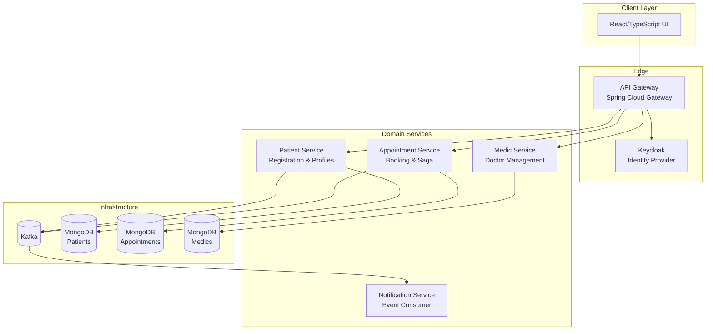

# Medical Centre Appointment Booking System

> **Version**: 1.0.0  
> **Java Version**: 25  
> **Spring Boot**: 4.2.0  
> **Spring Cloud**: 2025.0.0

## Overview

A microservices-based appointment booking platform for a Medical Centre. The system enables patients to register, browse medic availability, and book appointments through a React/TypeScript frontend. Medics can be managed by administrators. Notifications are sent for key lifecycle events via an event-driven Kafka backbone.

The platform follows **Domain-Driven Design (DDD)** with bounded contexts, **Event-Driven Architecture (EDA)** for inter-service communication, **Schema-First** API design (OpenAPI + Avro), and **Spec-Driven Development** for requirement tracking.

## Architecture



## Repository Structure

```
medical-centre/
├── README.md                          # This file
├── pom.xml                            # Parent Maven POM
├── docker-compose.yml                 # Local infrastructure
├── .env.example                       # Environment template
├── .gitignore
├── owasp-suppressions.xml             # CVE suppression rules
├── .github/workflows/
│   └── ci.yml                         # CI/CD pipeline
│
├── medical-centre-ui/                 # React/TypeScript Frontend
│   ├── Dockerfile
│   ├── package.json
│   └── src/
│       ├── main.tsx
│       ├── App.tsx
│       ├── types/
│       ├── services/
│       ├── components/
│       └── pages/
│
├── ms-api-gateway/                    # API Gateway (Spring Cloud Gateway)
│   ├── Dockerfile
│   ├── pom.xml
│   └── src/main/java/com/ew/medicalcentre/gateway/
│
├── ms-identity-service/              # Identity/Keycloak Service
│   ├── Dockerfile
│   ├── pom.xml
│   └── src/main/java/com/ew/medicalcentre/identity/
│
├── ms-patients-service/              # Patient Service
│   ├── Dockerfile
│   ├── pom.xml
│   ├── README.md
│   ├── TESTING.md
│   └── src/
│       ├── main/java/com/ew/medicalcentre/patient/
│       ├── test/java/com/ew/medicalcentre/patient/
│       └── test/resources/features/   # Cucumber BDD feature files
│
├── ms-medics-service/                # Medic Service
│   ├── Dockerfile
│   ├── pom.xml
│   └── src/
│       ├── main/java/com/ew/medicalcentre/medic/
│       └── test/java/com/ew/medicalcentre/medic/
│
├── ms-appointments-service/          # Appointment Service
│   ├── Dockerfile
│   ├── pom.xml
│   └── src/
│       ├── main/java/com/ew/medicalcentre/appointment/
│       └── test/java/com/ew/medicalcentre/appointment/
│
├── ms-notification-service/          # Notification Service
│   ├── Dockerfile
│   ├── pom.xml
│   └── src/
│       ├── main/java/com/ew/medicalcentre/notification/
│       └── test/java/com/ew/medicalcentre/notification/
│
├── acceptance-test/                   # Playwright E2E Acceptance Tests
│   ├── README.md
│   ├── pom.xml
│   └── src/test/
│       ├── java/com/ew/medicalcentre/acceptance/  # Playwright E2E tests
│       └── resources/features/                     # Gherkin feature specs
│
├── shared/                            # Shared contracts
│   ├── schemas/
│   │   ├── avro/                      # Kafka event schemas
│   │   └── openapi/                   # REST API specs
│   ├── kafka/
│   │   ├── topics/
│   │   └── config/
│   └── observability/
│       └── prometheus.yml
│
├── docs/
│   ├── adr/                           # Architecture Decision Records
│   │   ├── 001-domain-driven-design.md
│   │   ├── 002-event-driven-architecture.md
│   │   ├── 003-schema-first-approach.md
│   │   ├── 004-mongodb-per-service.md
│   │   └── 005-keycloak-auth.md
│   ├── specs/                         # Spec-Driven Development
│   │   ├── user-registration.md
│   │   ├── medic-registration.md
│   │   └── appointment-booking.md
│   ├── functional.md
│   └── technical.md
│
└── deploy/
    └── keycloak/
        └── realm-export.json           # Keycloak realm config
```

## Services Overview

| Service | Port | Purpose | Database |
|---------|------|---------|----------|
| `medical-centre-ui` | 3000 | React/TS frontend | — |
| `ms-api-gateway` | 8080 | Request routing | — |
| `ms-identity-service` | 8084 | Keycloak auth | — |
| `ms-patients-service` | 8080 | Patient registration | MongoDB |
| `ms-appointments-service` | 8081 | Appointment booking | MongoDB + Kafka |
| `ms-medics-service` | 8082 | Medic management | MongoDB |
| `ms-notification-service` | 8083 | Event notifications | Kafka consumer |

## Tech Stack

| Layer | Technology |
|-------|-----------|
| Frontend | React, TypeScript, Vite |
| Backend | Java 25, Spring Boot 4.2.0 |
| API Gateway | Spring Cloud 2025.0.0 |
| Database | MongoDB 7 |
| Messaging | Kafka (Confluent) |
| Schema | OpenAPI 3.x, Avro 1.11 |
| Auth | Keycloak (OAuth2/OIDC) |
| Containerization | Docker, Docker Compose |
| CI/CD | GitHub Actions |
| Observability | Prometheus, Grafana, OpenTelemetry |

## Testing

The project has three tiers of automated testing:

| Tier | Tool | Scope | Command |
|------|------|-------|---------|
| **Unit + Coverage** | JUnit 5 + JaCoCo (80% threshold) | Service logic | `mvn verify` |
| **API BDD** | Cucumber + RestAssured | REST endpoints | `mvn -pl ms-patients-service test` |
| **E2E Acceptance** | Playwright | Full UI flows | `mvn -pl acceptance-test test` |

### Test Coverage Enforcement
- **JaCoCo** 0.8.14 runs on every `mvn verify`
- **80% minimum** on INSTRUCTION, BRANCH, COMPLEXITY, LINE, METHOD, CLASS
- Build fails if coverage drops below threshold
- Reports at `target/site/jacoco/index.html`

### BDD API Tests
- Cucumber feature files in each service's `src/test/resources/features/`
- RestAssured-based step definitions in `src/test/java/.../bdd/`
- Run with: `mvn test`

### E2E Acceptance Tests
- Playwright browser automation in `acceptance-test/` module
- Covers: patient registration, login, appointment booking, medic management
- Requires all services running via Docker Compose

### Vulnerability Scanning
- **OWASP Dependency Check** runs on every build
- Fails on CVSS ≥ 7
- Weekly scheduled scan in CI

## Quick Start

```bash
# 1. Start infrastructure
docker-compose up -d kafka mongodb keycloak

# 2. Build all services (runs unit tests + JaCoCo coverage)
mvn clean verify

# 3. Start services (each in separate terminal or via docker-compose)
cd ms-patients-service && mvn spring-boot:run
cd ms-appointments-service && mvn spring-boot:run
cd ms-medics-service && mvn spring-boot:run
cd ms-notification-service && mvn spring-boot:run

# 4. Start frontend
cd medical-centre-ui && npm install && npm start

# 5. Run acceptance tests (requires all services running)
cd acceptance-test && mvn test
```

## CI/CD Pipeline

| Stage | Trigger | What |
|-------|---------|------|
| `build-and-test` | Push / PR | Unit tests + JaCoCo 80% coverage per service |
| `vulnerability-scan` | Push / PR / Weekly | OWASP Dependency Check |
| `frontend-build-and-test` | Push / PR | React build + lint |
| `acceptance-test` | After build passes | Docker Compose up → Playwright E2E |
| `docker-build` | Main branch | Build all container images |

## Documentation

- [Architecture Decision Records](docs/adr/)
- [Functional Requirements](docs/functional.md)
- [Technical Design](docs/technical.md)
- [Spec-Driven Development](docs/specs/)
- [Patient Service Testing](ms-patients-service/TESTING.md)
- [Acceptance Tests](acceptance-test/README.md)