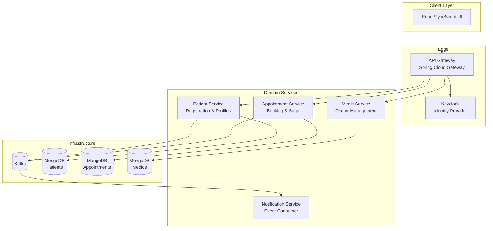

# Medical Centre Appointment Booking System

> **Version**: 1.0.0  
> **Java Version**: 25  
> **Spring Boot**: 4.2.0  
> **Spring Cloud**: 2025.0.0

## Overview

A microservices-based appointment booking platform for a Medical Centre. The system enables patients to register, browse medic availability, and book appointments through a React/TypeScript frontend. Medics can be managed by administrators. Notifications are sent for key lifecycle events via an event-driven Kafka backbone.

The platform follows **Domain-Driven Design (DDD)** with bounded contexts, **Event-Driven Architecture (EDA)** for inter-service communication, **Schema-First** API design (OpenAPI + Avro), and **Spec-Driven Development** for requirement tracking.

## Architecture



## Repository Structure

```
medical-centre/
├── README.md                          # This file
├── pom.xml                            # Parent Maven POM
├── docker-compose.yml                 # Local infrastructure
├── .env.example                       # Environment template
├── .gitignore
├── owasp-suppressions.xml             # CVE suppression rules
├── checkstyle.xml                     # Code style rules
├── spotbugs-exclude.xml               # SpotBugs exclusion rules
├── owasp-suppressions.xml             # CVE suppression rules
├── .github/workflows/
│   └── ci.yml                         # CI/CD pipeline
│
├── medical-centre-ui/                 # React/TypeScript Frontend
│   ├── Dockerfile
│   ├── package.json
│   └── src/
│       ├── main.tsx
│       ├── App.tsx
│       ├── types/
│       ├── services/
│       ├── components/
│       └── pages/
│
├── ms-api-gateway/                    # API Gateway (Spring Cloud Gateway)
│   ├── Dockerfile
│   ├── pom.xml
│   └── src/main/java/com/ew/medicalcentre/gateway/
│
├── ms-identity-service/              # Identity/Keycloak Service
│   ├── Dockerfile
│   ├── pom.xml
│   └── src/main/java/com/ew/medicalcentre/identity/
│
├── ms-patients-service/              # Patient Service
│   ├── Dockerfile
│   ├── pom.xml
│   ├── README.md
│   ├── TESTING.md
│   └── src/
│       ├── main/java/com/ew/medicalcentre/patient/
│       ├── test/java/com/ew/medicalcentre/patient/
│       └── test/resources/features/   # Cucumber BDD feature files
│
├── ms-medics-service/                # Medic Service
│   ├── Dockerfile
│   ├── pom.xml
│   └── src/
│       ├── main/java/com/ew/medicalcentre/medic/
│       └── test/java/com/ew/medicalcentre/medic/
│
├── ms-appointments-service/          # Appointment Service
│   ├── Dockerfile
│   ├── pom.xml
│   └── src/
│       ├── main/java/com/ew/medicalcentre/appointment/
│       └── test/java/com/ew/medicalcentre/appointment/
│
├── ms-notification-service/          # Notification Service
│   ├── Dockerfile
│   ├── pom.xml
│   └── src/
│       ├── main/java/com/ew/medicalcentre/notification/
│       └── test/java/com/ew/medicalcentre/notification/
│
├── acceptance-test/                   # Playwright E2E Acceptance Tests
│   ├── README.md
│   ├── pom.xml
│   └── src/test/
│       ├── java/com/ew/medicalcentre/acceptance/  # Playwright E2E tests
│       └── resources/features/                     # Gherkin feature specs
│
├── shared/                            # Shared contracts
│   ├── schemas/
│   │   ├── avro/                      # Kafka event schemas
│   │   └── openapi/                   # REST API specs
│   ├── kafka/
│   │   ├── topics/
│   │   └── config/
│   └── observability/
│       ├── README.md                  # Observability stack docs
│       ├── otel-collector-config.yml  # OpenTelemetry Collector pipeline
│       ├── loki-config.yml            # Grafana Loki config
│       ├── prometheus.yml             # Prometheus scrape targets
│       ├── promtail-config.yml        # Ship Docker logs to Loki
│       └── grafana/
│           ├── provisioning/
│           │   ├── datasources/
│           │   └── dashboards/
│           └── dashboards/
│               └── medical-centre-health.json
│
├── docs/
│   ├── adr/                           # Architecture Decision Records
│   │   ├── 001-domain-driven-design.md
│   │   ├── 002-event-driven-architecture.md
│   │   ├── 003-schema-first-approach.md
│   │   ├── 004-mongodb-per-service.md
│   │   ├── 005-keycloak-auth.md
│   ├── specs/                         # Spec-Driven Development
│   │   ├── user-registration.md
│   │   ├── medic-registration.md
│   │   └── appointment-booking.md
│   ├── functional.md
│   └── technical.md
│
├── deploy/
│   └── keycloak/
│       └── realm-export.json           # Keycloak realm config
```

## Services Overview

| Service | Port | Purpose | Database |
|---------|------|---------|----------|
| `medical-centre-ui` | 3000 | React/TS frontend | — |
| `ms-api-gateway` | 8080 | Request routing | — |
| `ms-identity-service` | 8084 | Keycloak auth | — |
| `ms-patients-service` | 8080 | Patient registration | MongoDB |
| `ms-appointments-service` | 8081 | Appointment booking | MongoDB + Kafka |
| `ms-medics-service` | 8082 | Medic management | MongoDB |
| `ms-notification-service` | 8083 | Event notifications | Kafka consumer |

## Technology Stack

### Core Platform
| Layer | Technology | Version |
|-------|------------|---------|
| **Language** | Java | 25 (LTS) |
| **Build Tool** | Maven | 3.9+ |
| **Runtime** | Eclipse Temurin | 25 |

### Backend Framework
| Component | Technology | Version |
|-----------|------------|---------|
| **Core Framework** | Spring Boot | 4.2.0 |
| **Cloud Framework** | Spring Cloud | 2025.0.0 |
| **API Gateway** | Spring Cloud Gateway | 4.2.0 |
| **Service Discovery** | Built-in (Spring Cloud) | — |
| **Security** | Spring Security + Keycloak | 6.3+ / 26.0 |
| **Validation** | Jakarta Validation (Hibernate Validator) | 8.0+ |
| **Actuator/Monitoring** | Micrometer + Prometheus | 1.14+ |

### Data & Persistence
| Component | Technology | Version |
|-----------|------------|---------|
| **Primary Database** | MongoDB | 7.x |
| **ODM** | Spring Data MongoDB | 4.2.0 |
| **Messaging** | Apache Kafka | 3.8+ (Confluent) |
| **Kafka Client** | Spring Kafka | 4.2.0 |
| **Schema Registry** | Avro | 1.11.3 |
| **API Specs** | OpenAPI | 3.1 |

### Frontend
| Layer | Technology | Version |
|-------|------------|---------|
| **Framework** | React | 18.3 |
| **Language** | TypeScript | 5.6 |
| **Build Tool** | Vite | 5.4 |
| **Router** | React Router DOM | 6.27 |
| **HTTP Client** | Axios | 1.7 |
| **Styling** | Tailwind CSS | 3.4 |
| **State Management** | React Hooks / Context | — |
| **Testing** | Playwright | 1.65 |

### Observability Stack
| Signal | Technology | Version |
|--------|------------|---------|
| **Tracing** | OpenTelemetry (JS + Java Agent) | 1.30+ / 1.40+ |
| **Trace Backend** | Jaeger | 1.58+ |
| **Metrics** | Micrometer + Prometheus | 1.14+ / 2.54+ |
| **Logs** | Loki + Promtail | 3.1+ |
| **Visualization** | Grafana | 11.0+ |
| **Collector** | OpenTelemetry Collector | 0.122+ |

### Build & CI/CD
| Tool | Technology | Version |
|------|------------|---------|
| **Build Tool** | Maven | 3.9+ |
| **Containerization** | Docker | 24.0+ |
| **Orchestration** | Docker Compose | 2.27+ |
| **CI/CD** | GitHub Actions | — |
| **Vulnerability Scanning** | OWASP Dependency Check | 11.1 |
| **Code Style** | Checkstyle | 3.3 |
| **Static Analysis** | SpotBugs | 4.8.6 |
| **Coverage** | JaCoCo | 0.8.14 |

### Testing
| Tier | Tool | Scope |
|------|------|-------|
| Unit + Coverage | JUnit 5 + JaCoCo (80%) | Service logic |
| API BDD | Cucumber + RestAssured | REST endpoints |
| E2E Acceptance | Playwright | Full UI flows |

### Development & Quality
| Tool | Technology |
|------|------------|
| **IDE Support** | Lombok 1.18.42 |
| **Code Style** | Checkstyle 3.3.1 |
| **Static Analysis** | SpotBugs 4.8.6 |
| **Dependency Scanning** | OWASP Dependency Check 11.1 |

## Observability

The system ships with a full OpenTelemetry-based observability stack — distributed tracing from the UI through the API Gateway to every service, metrics via Micrometer + Prometheus, and logs aggregated in Loki.

### Signal flow

| Signal | Producer | Storage |
|--------|----------|---------|
| **Traces** | OTel JS (UI) + OTel Java agent (services) | Jaeger |
| **Metrics** | Micrometer → `/actuator/prometheus` | Prometheus |
| **Logs** | Docker container stdout | Promtail → Grafana Loki |

Traces flow through an **OpenTelemetry Collector** (`otel-collector:4318`) which fans out to Jaeger and Prometheus.

### Access (local docker-compose)

| Service | URL |
|---------|-----|
| Grafana (dashboards) | http://localhost:3001 (admin / admin) |
| Jaeger (traces) | http://localhost:16686 |
| Prometheus (metrics) | http://localhost:9090 |

### Grafana dashboard

Pre-provisioned **"Medical Centre — Services Health"** dashboard shows per-service status, request rate, error rate, latency p50/p95/p99, JVM heap, GC pause, and recent error logs. See [shared/observability/README.md](shared/observability/README.md) for details.

### Trace propagation

A single request is traced end-to-end: **UI** sends the W3C `traceparent` header → **API Gateway** → **domain service**. Spring Boot services use `micrometer-tracing-bridge-otel` for automatic W3C propagation.

## Testing

The project has three tiers of automated testing:

| Tier | Tool | Scope | Command |
|------|------|-------|---------|
| **Unit + Coverage** | JUnit 5 + JaCoCo (80% threshold) | Service logic | `mvn verify` |
| **API BDD** | Cucumber + RestAssured | REST endpoints | `mvn -pl ms-patients-service test` |
| **E2E Acceptance** | Playwright | Full UI flows | `mvn -pl acceptance-test test` |

### Test Coverage Enforcement
- **JaCoCo** 0.8.14 runs on every `mvn verify`
- **80% minimum** on INSTRUCTION, BRANCH, COMPLEXITY, LINE, METHOD, CLASS
- Build fails if coverage drops below threshold
- Reports at `target/site/jacoco/index.html`

### BDD API Tests
- Cucumber feature files in each service's `src/test/resources/features/`
- RestAssured-based step definitions in `src/test/java/.../bdd/`
- Run with: `mvn test`

### E2E Acceptance Tests
- Playwright browser automation in `acceptance-test/` module
- Covers: patient registration, login, appointment booking, medic management
- Requires all services running via Docker Compose

### Vulnerability Scanning
- **OWASP Dependency Check** runs on every build
- Fails on CVSS ≥ 7
- Weekly scheduled scan in CI

## Quick Start

```bash
# 1. Start infrastructure
docker-compose up -d kafka mongodb keycloak

# 2. Build all services (runs unit tests + JaCoCo coverage)
mvn clean verify

# 3. Start services (each in separate terminal or via docker-compose)
cd ms-patients-service && mvn spring-boot:run
cd ms-appointments-service && mvn spring-boot:run
cd ms-medics-service && mvn spring-boot:run
cd ms-notification-service && mvn spring-boot:run

# 4. Start frontend
cd medical-centre-ui && npm install && npm start

# 5. Run acceptance tests (requires all services running)
cd acceptance-test && mvn test
```

## CI/CD Pipeline

| Stage | Trigger | What |
|-------|---------|------|
| `build-and-test` | Push / PR | Unit tests + JaCoCo 80% coverage per service |
| `vulnerability-scan` | Push / PR / Weekly | OWASP Dependency Check |
| `frontend-build-and-test` | Push / PR | React build + lint |
| `acceptance-test` | After build passes | Docker Compose up → Playwright E2E |
| `docker-build` | Main branch | Build all container images |

## Documentation

- [Architecture Decision Records](docs/adr/)
- [Functional Requirements](docs/functional.md)
- [Technical Design](docs/technical.md)
- [Spec-Driven Development](docs/specs/)
- [Patient Service Testing](ms-patients-service/TESTING.md)
- [Acceptance Tests](acceptance-test/README.md)
- [Observability Stack](shared/observability/README.md)