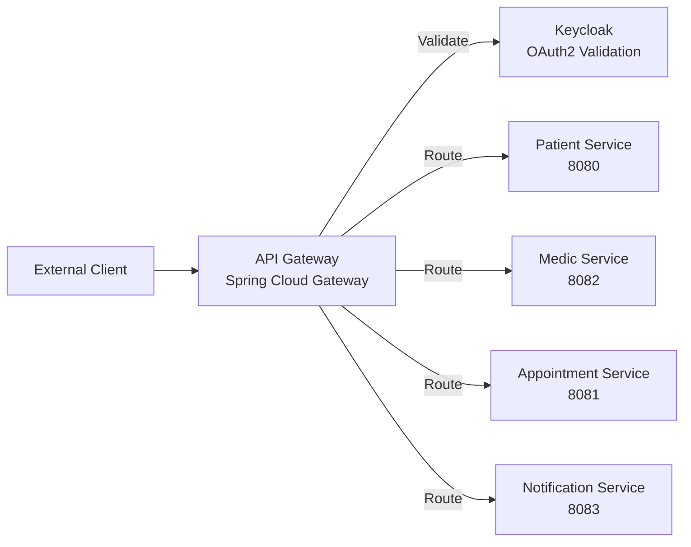

# API Gateway

> **Module**: `ms-api-gateway`  
> **Package**: `com.ew.medicalcentre.gateway`  
> **Port**: 8080

## Overview

Spring Cloud API Gateway that routes all external requests to the appropriate domain service. Performs authentication/authorization via Keycloak and provides centralized request filtering.

## Architecture



## Tech Stack

- Java 25, Spring Boot 3.4.0
- Spring Cloud Gateway
- OAuth2 Resource Server (Keycloak)
- Spring Cloud Circuit Breaker (Resilience4j)

## Build & Run

```bash
cd ms-api-gateway
../mvnw clean package -DskipTests
../mvnw spring-boot:run
```

## Route Configuration

Routes defined in `application.yml`:

| Route | Target Service | Path Prefix |
|-------|---------------|------------|
| `/patients/**` | `ms-patients-service` | `/api/v1/patients` |
| `/medics/**` | `ms-medics-service` | `/api/v1/medics` |
| `/appointments/**` | `ms-appointments-service` | `/api/v1/appointments` |
| `/notifications/**` | `ms-notification-service` | `/api/v1/notifications` |

## Configuration

See `src/main/resources/application.yml`.