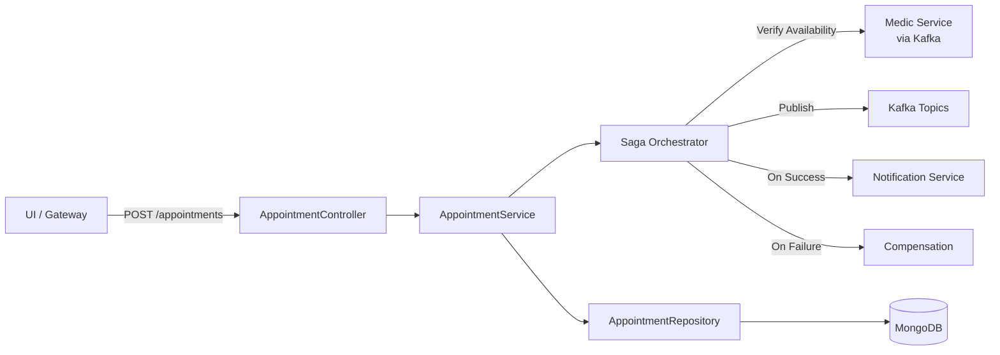

# Appointment Service

> **Module**: `ms-appointments-service`  
> **Package**: `com.ew.medicalcentre.appointment`  
> **Port**: 8081

## Overview

Appointment booking and lifecycle management microservice. Orchestrates appointment creation via saga pattern when medic availability must be verified. Emits `AppointmentBooked`, `AppointmentUpdated`, and `AppointmentReminder` events.

## Architecture



## Tech Stack

- Java 25, Spring Boot 3.4.0
- Spring Data MongoDB
- Spring Kafka (Producer)
- OAuth2 Resource Server (Keycloak)
- Saga Pattern for distributed transactions

## Build & Run

```bash
# Build
cd ms-appointments-service
../mvnw clean package -DskipTests

# Run
../mvnw spring-boot:run
```

## API Endpoints

| Method | Path | Description |
|--------|------|-------------|
| POST | `/api/v1/appointments` | Book an appointment |
| GET | `/api/v1/appointments/{id}` | Get appointment details |
| PUT | `/api/v1/appointments/{id}` | Update appointment |
| DELETE | `/api/v1/appointments/{id}` | Cancel appointment |
| GET | `/api/v1/appointments/patient/{patientId}` | List patient appointments |

## Kafka Topics Produced

- `appointment-booked` (Avro)
- `appointment-updated` (Avro)
- `appointment-reminder` (Avro)

## Configuration

See `src/main/resources/application.yml`.