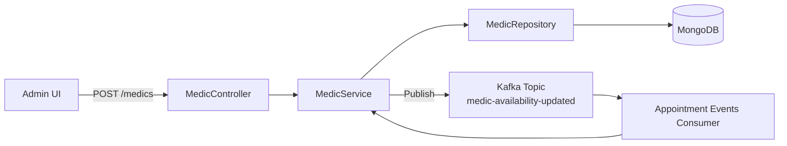

# Medic Service

> **Module**: `ms-medics-service`  
> **Package**: `com.ew.medicalcentre.medic`  
> **Port**: 8082

## Overview

Medic/doctor management microservice. Stores medic details, specializations, and availability schedules. Consumes appointment-related events to track booked slots. Emits `MedicAvailabilityUpdated` events.

## Architecture



## Tech Stack

- Java 25, Spring Boot 3.4.0
- Spring Data MongoDB
- Spring Kafka (Producer + Consumer)
- OAuth2 Resource Server (Keycloak)

## Build & Run

```bash
cd ms-medics-service
../mvnw clean package -DskipTests
../mvnw spring-boot:run
```

## API Endpoints

| Method | Path | Description |
|--------|------|-------------|
| POST | `/api/v1/medics` | Register a new medic |
| GET | `/api/v1/medics/{id}` | Get medic details |
| PUT | `/api/v1/medics/{id}` | Update medic info |
| GET | `/api/v1/medics/{id}/availability` | Get medic availability |
| PUT | `/api/v1/medics/{id}/availability` | Set availability |
| GET | `/api/v1/medics` | List all medics |

## Kafka Topics

- **Consumes**: `appointment-booked`, `appointment-updated`, `appointment-cancelled`
- **Produces**: `medic-availability-updated` (Avro)

## Configuration

See `src/main/resources/application.yml`.