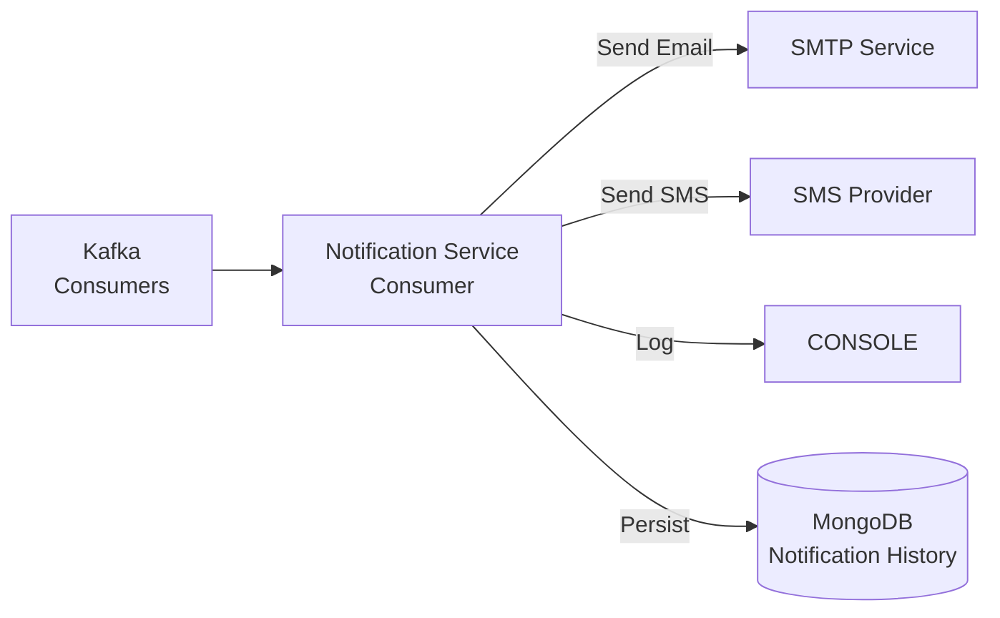

# Notification Service

> **Module**: `ms-notification-service`  
> **Package**: `com.ew.medicalcentre.notification`  
> **Port**: 8083

## Overview

Event-driven notification microservice. Consumes Kafka events (appointment-booked, appointment-reminder) and sends emails/SMS notifications. Decouples notification logic from business services.

## Architecture



## Tech Stack

- Java 25, Spring Boot 3.4.0
- Spring Kafka (Consumer)
- Spring Boot Actuator
- FreeMarker / Thymeleaf (email templates)
- OAuth2 Resource Server (Keycloak - for service-to-service auth)

## Build & Run

```bash
cd ms-notification-service
../mvnw clean package -DskipTests
../mvnw spring-boot:run
```

## Configuration

See `src/main/resources/application.yml`.

## Kafka Topics Consumed

- `appointment-booked` (Avro)
- `appointment-reminder` (Avro)

## Notes

- Notification templates stored in `src/main/resources/templates/`
- Email addresses stored encrypted in MongoDB
- Dead-letter queue handling for failed deliveries