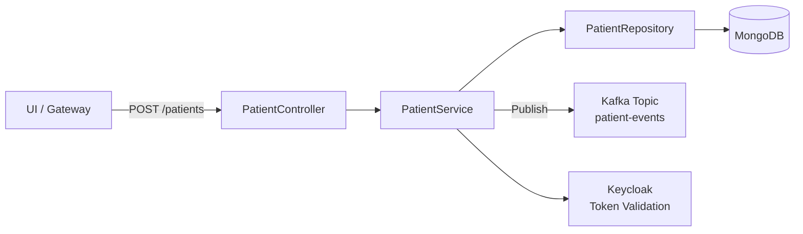

# Patient Service

> **Module**: `ms-patients-service`  
> **Package**: `com.ew.medicalcentre.patient`  
> **Port**: 8080

## Overview

Patient registration and profile management microservice. Handles patient onboarding, profile updates, and emits `PatientRegistered` events to Kafka upon successful registration.

## Architecture



## Tech Stack

- Java 25, Spring Boot 3.4.0
- Spring Data MongoDB
- Spring Kafka
- OAuth2 Resource Server (Keycloak)

## Build & Run

```bash
# Build
cd ms-patients-service
../mvnw clean package -DskipTests

# Run (requires MongoDB + Kafka + Keycloak)
../mvnw spring-boot:run
```

## API Endpoints

| Method | Path | Description |
|--------|------|-------------|
| POST | `/api/v1/patients` | Register a new patient |
| GET | `/api/v1/patients/{id}` | Get patient profile |
| PUT | `/api/v1/patients/{id}` | Update patient profile |
| GET | `/api/v1/patients` | List all patients (admin) |

## Configuration

See `src/main/resources/application.yml`.