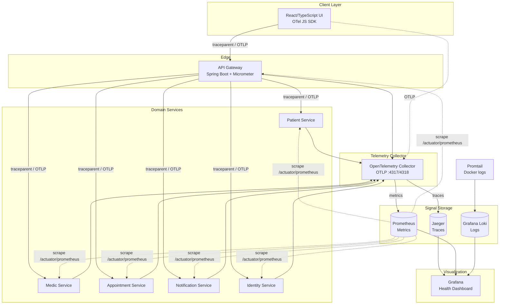

# Observability Stack

Medical Centre uses a full-stack OpenTelemetry-based observability platform:



## Signal flow

| Signal | Producer | Transport | Storage | UI |
|--------|----------|-----------|---------|----|
| **Traces** | OTel JS (UI) + OTel Java agent (services) | OTLP HTTP/gRPC `:4318`/`:4317` | Jaeger | Grafana Jaeger datasource |
| **Metrics** | Micrometer Prometheus registry on `/actuator/prometheus` | Prometheus scrape | Prometheus | Grafana Prometheus datasource |
| **Logs** | Stdout (Logback JSON) | Promtail tails Docker socket | Loki | Grafana Loki datasource |

## Access URLs (local docker-compose)

| Service | URL | Purpose |
|---------|-----|---------|
| Grafana | http://localhost:3001 | Dashboards (admin / admin) |
| Jaeger | http://localhost:16686 | Trace search & waterfall |
| Prometheus | http://localhost:9090 | Metrics query (PromQL) |
| OTel Collector | http://localhost:4318 | OTLP HTTP endpoint |
| OTel Collector health | http://localhost:13133 | Health check |

## Configuration

| File | Purpose |
|------|---------|
| `shared/observability/otel-collector-config.yml` | Collector pipelines: traces → Jaeger, metrics → Prometheus |
| `shared/observability/prometheus.yml` | Scrape targets for all services |
| `shared/observability/loki-config.yml` | Loki log storage config |
| `shared/observability/promtail-config.yml` | Ship Docker container logs → Loki |
| `shared/observability/grafana/provisioning/datasources/datasources.yml` | Pre-provisioned Prometheus/Loki/Jaeger datasources |
| `shared/observability/grafana/dashboards/medical-centre-health.json` | Services Health dashboard (pre-loaded) |

## Docker Compose

```bash
# Start full observability stack
docker-compose up -d otel-collector loki promtail jaeger prometheus grafana

# Start everything including services
docker-compose up -d
```

## Service integration

Each Spring Boot service depends on:

- `micrometer-registry-prometheus` — exposes `/actuator/prometheus`
- `micrometer-tracing-bridge-otel` — W3C trace context propagation
- `opentelemetry-exporter-otlp` — exports traces via OTLP to the collector

**Trace propagation** works automatically: UI → API Gateway → Services via the `traceparent` header (W3C), so a single request trace spans frontend, gateway, and backend services.

Add to any service `application.yml`:
```yaml
management:
  tracing:
    sampling:
      probability: 1.0
    otlp:
      tracing:
        endpoint: ${OTEL_EXPORTER_OTLP_ENDPOINT:http://localhost:4318/v1/traces}
  metrics:
    tags:
      application: ${spring.application.name}
  endpoints:
    web:
      exposure:
        include: health,info,metrics,prometheus
```

## Grafana dashboards

The **Medical Centre — Services Health** dashboard is pre-provisioned on first Grafana start and shows:

- Service status (up/down)
- Request rate (req/s) per service
- Error rate (5xx %)
- HTTP latency p50/p95/p99
- JVM heap memory
- GC pause duration
- Recent error logs (Loki)
